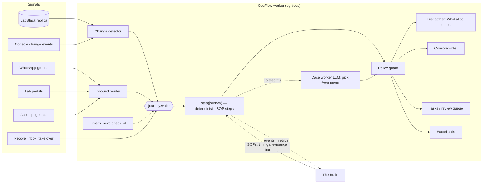
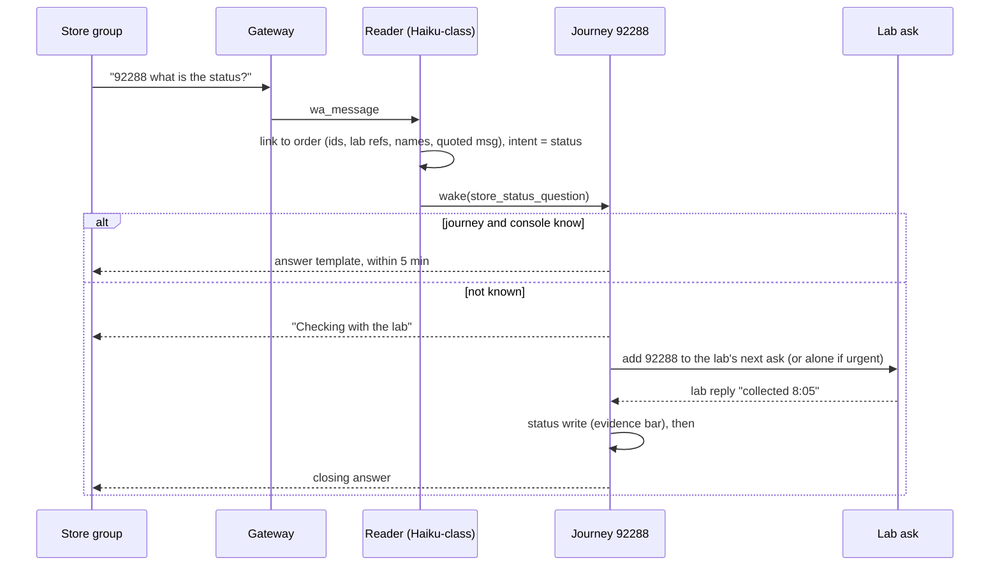
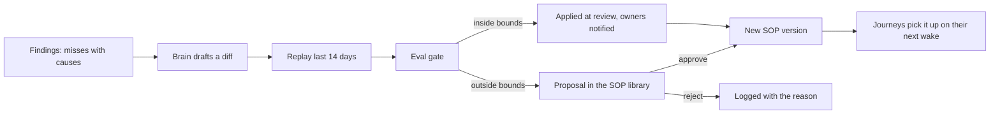

# OpsFlow Agents — product and system design

Status: design for build, 21 Oct 2026; decisions of 21 Oct folded in (section 16). Source: "OpsFlow AI Ops Agents — Product Spec" (20 Oct 2026).
Builds on: `DOCS/features/provider-communication/DESIGN.md` (message rules), `ORDER-JOURNEY-AGENT.md`
(journeys, promises, ladder), `TIMELINE-WALKTHROUGH.md` (where today's bot still fails).

This repo is public. People are named by role here. Labs and stores are named only in the pilot
list (section 16), as the code already names them; elsewhere they are named by tier. "SOP owners"
are the two founders who approve SOP changes. "Lab A" is an API lab that assigns phlebos about
30 min before the slot. "Store S1" is the largest store group.

---

## 0. The product in one page

OpsFlow Agents runs lab-order operations the way a good ops team does. Every open order has one
owner at all times. That owner is software (the order agent) unless a person takes the order over.

Three things run it:

| Part | What it is, concretely | Runs how often | Uses an LLM? |
|---|---|---|---|
| **Order agent** | A journey row per open order plus one pure function, `step()`, that reads the order's state and returns the next actions. "600 agents" means 600 rows, not 600 processes. | On every wake: due timer, console change, inbound message, person action, start of a rhythm block | Only the reader (to turn text into facts) and, rarely, the case worker (to pick from a fixed menu) |
| **Dispatcher + policy guard** | The single exit. Every action an agent wants goes through it: menu check, hard rules, kill switches, autonomy level, idempotency, caps, quiet hours, batching. | Continuously; message flushes at slots | No |
| **The Brain** | One planning agent. It writes and revises SOPs, tunes timings, reads the metrics, audits, and writes the daily brief. It never sends messages and never sits in a per-order decision. | Monitor every 30 min (no LLM unless something is wrong), nightly run, review cycle | Yes, the strongest model, a few times a day |

People sit at two levels:

- **Ops executives** work an exception inbox: tasks and review items the agent may not or cannot
  do, each with the evidence, the exact action and a console deep link.
- **SOP owners** approve SOP changes outside agreed bounds, set autonomy, and read the Brain's brief.

The console (LabStack) stays the source of truth for order data. OpsFlow owns everything about the
work: journeys, facts, promises, asks, tasks, audit. Agents change order data only through the
console write API, and only for five transitions.



---

## 1. What I would pin down or change in the spec

The spec is coherent. These are the places where building it literally would hurt, with a
recommendation for each. Items marked **Decide** need an SOP owner's call before the relevant phase.

1. **"Agent" must be a pure reducer, or replay is impossible.** FR-5.5 and FR-14.4 need "replay this
   SOP change against two weeks of orders". That only works if the agent's decision is a function of
   recorded inputs: `step(journeyState, consoleSnapshot, newEvents, sopVersion, now)`. Every input,
   including each LLM output, is stored as a journey event. Replay re-runs `step()` over the event
   log with the candidate SOP and diffs the actions. This is the most important architectural
   constraint in this document.

2. **OpsFlow has to keep a snapshot of the console order, even though it is not the truth.** The spec
   says OpsFlow never stores its own copy of order status. Change detection (until console events
   exist) and replay both need the last-seen console state. Store it as a fingerprint plus snapshot on
   the journey, labelled as a cache. Every decision re-reads the replica; the snapshot only answers
   "what changed since I last looked".

3. **Quiet hours contradict the morning block.** FR-8.1 says no lab messages 20:00 to 08:30. The
   morning block starts at 06:00, Flow 1 sends a 07:00 ask, and Flow 9 warns a store at 06:00.
   **Decided 21 Oct: quiet hours depend on the order.** There is no fixed clock window. Each ask gets
   a send window from its own order's checkpoint, and asks not tied to a near slot follow the
   counterparty's working hours. Section 4.15 has the rule.

4. **The autonomy matrix will never fill.** "98% agreement over 200 cases" per action × lab × store
   is thousands of cells, and most will never see 200 cases. **Decided 21 Oct:** measure and promote
   at action × lab tier (A/B/C) × desk. A lab or store can override only downward (demote), or upward
   once its own sample reaches 200. Same gate, reachable in weeks instead of never.

5. **Two confidence thresholds.** Appendix B says 0.7, FR-3.2 says 0.8. Recommendation: one evidence
   bar per transition, defaulting to auto-write at 0.85 or above with a named order, review between
   0.5 and 0.85, note only below 0.5. The Brain tunes it per lab × transition at review.
   **Decided 21 Oct.**

6. **Two senders during migration.** Today's message rules send to every lab. If a Lab desk goes to
   shadow while the rules keep sending, it is fine. When it goes live for a lab, the rules for that lab
   must stop in the same transaction, or hard rule 4 breaks. Plan: the current standard message set
   becomes **Lab desk SOP v0** (same asks, same templates, same slots), and "desk live for lab X"
   excludes lab X from the legacy rules atomically.

7. **The Brain does not need the strongest model every 30 minutes.** The 30-minute run is a
   deterministic monitor (SQL plus thresholds: lab silent at peak, breach spike, overdue tasks). It
   calls the LLM only when a threshold trips and needs a diagnosis. The nightly brief and the review
   cycle use the strongest model. This is a design choice for speed and signal, not cost: cost is
   tracked but not capped for now (decided 21 Oct).

8. **Store warnings are customer-visible, so they need autonomy too.** "Order 92144 is at risk" in a
   store group is an action with a cost if wrong. FR-16.4 does not say it starts in suggest mode. It
   should, like every other store-facing action except template answers to status questions.

9. **Patient Missed and Phlebo No Show are not like Sample Collected.** Both are allowed transitions
   (FR-3.1), but a wrong one triggers a store alert and counts against the lab. Keep these two in
   suggest mode until the evidence bar has its own 200-case record, even where Sample Collected is
   live.

10. **The 5-minute task sweep and the 1-minute read requirement.** The task engine polls every 5
    minutes; FR-1.3 needs a read every minute and within seconds on events. The agent worker gets its
    own 1-minute change detector on the active window only (about 600 orders), separate from the
    5-minute poller, as the non-API lab tick already is.

11. **"No per-lab configuration" still holds, with one clarification.** The Brain sets per-lab
    timings from history (FR-2.5). Those are data the Brain writes and the SOP owners approve, not a
    form ops fills per lab. The only per-lab or per-store controls people touch are rollout controls:
    desk state, autonomy overrides and kill switches.

12. **Console write APIs are the critical dependency.** Until they ship, a status write becomes a
   one-click task ("Mark #92288 Sample Collected — evidence: lab reply 08:05"). The pipeline is the
   same; only the executor differs. Desks can go live before the APIs exist. **Decided 21 Oct:** API
   dates are not a planning input yet; the task fallback is the plan until they land.

---

## 2. Concepts as concrete objects

| Spec term | Object in the system | Lives in |
|---|---|---|
| Order | LabStack `Order` row | Replica (read), console API (write) |
| Journey | `agent_journey` row, one per order in the active window | OpsFlow DB |
| Order agent | `step()` in `src/lib/agents/journey/step.ts`, run by the `journey.wake` job | Worker |
| Checkpoint | `agent_checkpoint` rows per journey: name, due_at, due_source, status | OpsFlow DB |
| SLA policy | Console table (later); `SlaMilestoneConfig` shim plus Brain-set per-lab offsets (now) | Console / OpsFlow |
| Fact | `ProviderOrderFact`, extended with `source` and `reviewed_by` | OpsFlow DB |
| Promise | `agent_promise` rows: kind, due_at, status, fact id | OpsFlow DB |
| Ask | `agent_outbox_item` (one order in one ask) grouped into a `ProviderBatch` (one message) | OpsFlow DB |
| Evidence bar | SOP section: per lab tier × transition, which sources count and at what confidence | SOP version |
| Autonomy level | `agent_autonomy` row per action × scope | OpsFlow DB |
| Review item | `agent_review_item` row | OpsFlow DB |
| Task | Existing `Task` with new task types and `metadata.agent` payload | OpsFlow DB |
| Take over | `agent_journey.owner_user_id` plus `paused_until` | OpsFlow DB |
| SOP | `agent_sop` and `agent_sop_version` (typed JSON body) | OpsFlow DB |
| Desk | Section of the SOP plus `agent_desk_state` per desk × lab or store | OpsFlow DB |
| Brain run | `agent_brain_run` row with its inputs, outputs, cost | OpsFlow DB |

---

## 3. Configuration: from zero to the first live desk

Setup happens once, in a **Setup** page in the lead console. Each step has a status (not started,
in progress, done) and blocks the next. Nothing sends until step 8.

### Step 1. Connections

One health card per connection. Each must be green before the desks that need it can leave "off".

| Connection | Needed by | Green when |
|---|---|---|
| LabStack replica | Everything | Query under 2 s, replica lag under 60 s |
| Console change events (webhook or outbox) | Faster wake-ups (optional at first) | A test event round-trips |
| Console write API (service account) | Status writes in act mode | A dry-run write against a test order returns 200 with the idempotency key echoed |
| WhatsApp gateway, dedicated agent number (already configured) | Lab and Store desks | Connected, the number is in every configured group |
| Exotel | Calls rung (P1) | Test call to an internal number |
| Lab portal sessions, credentials in the OpsFlow vault (4.12) | Portal reads (Tier A/B labs) | Session logged in and a read of a known order succeeds |
| LLM provider keys | Reader, case worker, Brain | A canary prompt passes |

### Step 2. Directory

These are facts about the world, mostly filled automatically, with a person confirming.

- **Labs.** Tier (A API, B portal, C manual) from the console's integration type. WhatsApp group
  (existing Connections page). Coordinator, auto-picked as the most active lab-side writer in 30 days.
  Manager phone. Portal yes or no. Working hours and holidays.
- **Stores.** WhatsApp group. Weight for inbox sorting (PPMC, VIP, key account). Status API opt-in.
  Whether the store wants a 19:00 day summary.
- **Team.** Already exists: skills, store assignments, roster. New: which task types each skill takes
  (reschedule, report upload, network, escalation).

### Step 3. SLA policy and checkpoints

The checkpoint set per order type comes from the spec (eight for home sample). The default offsets
come from the ops team's rules. The page then shows, per lab, what the history says:

```
Lab A (Tier A)          default      lab history (30 d)       proposed
Phlebo assigned         slot −2 h    p50 slot −28 min         slot −30 min   [accept] [keep default]
Sample collected        slot +30     p50 slot +6, p90 +34     slot +30       (no change)
Report delivered        lab TAT 24h  p50 6 h, p90 26 h        24 h, chase 26 h
```

The proposals are computed by a deterministic query, not the LLM. Accepting writes them to the SLA
shim (until the console holds the policy, FR-2.1).

### Step 4. Baseline SOPs

The Brain's one-time authoring run (FR-4.2) takes:

- 30 days of orders, milestone timelines and internal notes from the replica;
- 30 days of lab and store group messages;
- the ops playbook documents;
- the hard rules and checkpoints in this design;
- today's standard message set (the Lab desk's v0).

It produces one draft SOP per desk (Intake, Lab, Store; Kit and Escalation later) in the typed format
of section 6, each step annotated with the evidence it came from ("seen in 41 chats", "playbook §3").
The SOP owners review it in the SOP library as a readable document, edit inline, and approve. The
approval creates `v1`.

### Step 5. Evals

The eval set (FR-14.3) is built from labelled history: store messages with their intents, lab
replies with their facts, and October chats. Setup runs every suite against the approved SOP and
prompts. Each suite has a gate:

| Suite | Measures | Gate to leave shadow |
|---|---|---|
| Lab reply reader | Facts per order, the right order | Precision ≥ 0.97 on status-bearing facts |
| Store message linker | The right order id | ≥ 0.95, and never a confident wrong link |
| Store intent classifier | 10 intents | Macro-F1 ≥ 0.9; reschedule and cancel recall ≥ 0.98 |
| Case worker | Menu choice matches the labelled one | ≥ 0.9 (it stays in suggest mode anyway) |
| Template answers | The answer states what the console says | 100% on 200 status questions |

### Step 6. Desks

A matrix of desk × lab (Lab, Intake, Kit) or desk × store (Store, Escalation). Each cell is off,
shadow or live. Setup puts every cell to **shadow** for the pilot labs and stores (section 16), and
off elsewhere.

### Step 7. Autonomy

Defaults, by action, at the lab-tier level. Store warnings and the two risky transitions start in
suggest until the SOP owners say otherwise (section 16).

| Action | Default | Can rise to |
|---|---|---|
| Lab ask (batched, templated) | act | — (already live today) |
| Store answer from console data | act and notify | act |
| Store "noted" plus task for a change request | act | — |
| Store at-risk warning | suggest | act and notify |
| Status write: Phlebo Started, Sample Collected, Sample Delivered | suggest | act |
| Status write: Patient Missed, Phlebo No Show | suggest | act and notify |
| Manager WhatsApp, Exotel call | act and notify | act |
| Case worker choice | suggest | act and notify, per menu item |

### Step 8. Guardrails and the go-live checklist

Caps (per lab per slot, per lab per day, per order per day), the order-based send windows (4.15),
and the kill-switch drill (pause one lab, confirm nothing sends, resume). Cost is shown per order and
per desk but not capped. Then the checklist:

- [ ] Shadow has run at least 7 days for the pilot cell.
- [ ] Shadow agreement for every act-level action in the cell is at the gate.
- [ ] The team has been told which asks the agent owns in that group (FR-7.3).
- [ ] The rollback rule is armed: the desk returns to shadow if team messages per order in that group
      have not fallen within 14 days of going live.

---

## 4. Runtime: how one order is executed

### 4.1 The journey

A journey opens when an order enters the active window (FR-1.1): appointment from 7 days ago to 3
days ahead, or any non-terminal order with activity in 7 days. Older open orders go once to a
clean-up list.

```ts
type Journey = {
  orderId: number; orderType: string; labId: number; storeId: number | null;
  stage: ConsoleStatus;              // from the console, never set by OpsFlow
  subStates: string[];               // urine_pending, partial_report, recollection, change_pending
  waitingFor: { what: CheckpointName; from: "LAB" | "STORE" | "OPS" | "COURIER" } | null;
  dueAt: Date | null; dueSource: "POLICY" | "PROMISE";
  nextCheckAt: Date | null;
  health: "ON_TRACK" | "AT_RISK" | "BREACHED";
  risk: { level: "LOW" | "MEDIUM" | "HIGH"; reasons: string[] };
  owner: { kind: "AGENT" } | { kind: "PERSON"; userId: number; until: Date };
  attempts: Record<string, number>;  // per checkpoint × ask
  brokenPromises: number;
  sopVersionId: string;
  consoleFingerprint: string;        // cache for change detection only
  openedAt: Date; closedAt: Date | null;
};
```

### 4.2 What wakes a journey

| Source | How it reaches the journey |
|---|---|
| Timer | A 1-minute sweep enqueues every journey with `next_check_at <= now` |
| Console change | The change detector diffs the replica every minute for active orders; console events, when they ship, enqueue within seconds |
| Rhythm block start | At 06:00, 11:00, 14:00, 18:00 every journey in scope is enqueued, spread over 10 minutes |
| Inbound message | The reader links a lab reply, store message, action-page tap or portal read to an order and enqueues it |
| Person | Take over, hand back, approve or edit a review item, close a task |

All of these become a `journey.wake` job with `singletonKey = orderId`. pg-boss runs at most one job
per key at a time, so two agents can never act on one order (FR-1.2), without any lock code.

### 4.3 One wake, step by step

```
wake(orderId, reason):
  j      = load journey
  snap   = read order from the replica (status, slot, lab, type, tests, notes, report state)
  events = journey events not yet applied (facts, taps, person actions, console changes)

  1. Reconcile with the console
     if fingerprint(snap) != j.consoleFingerprint:
        classify the change: reschedule, cancel, reroute, tests changed, type changed,
                             recollection, patient missed, plain status progress
        apply the clock-reset rule for it (section 4.4)
        record a console_change event
  2. Terminal?  REPORT_DELIVERED or CANCELLED: withdraw everything, close, stop.
  3. Taken over? Only observe: update checkpoints and health, emit no actions.
  4. Apply events: facts become facts; facts with a time become promises
     (a newer promise supersedes; a missed one increments brokenPromises).
  5. Checkpoints: mark met where the console or evidence shows it; recompute health
     (at risk within 15 min of due, breached after).
  6. Status write: if a fact meets the evidence bar for an allowed transition
     the console has not reached yet, propose console.write.
  7. SOP steps: for the checkpoint we wait on, pick the matching step
     (rung = attempts × brokenPromises × time to due × rhythm block) and propose its actions.
  8. No step fits, a conflicting fact, or 2 broken promises: call the case worker (4.6).
  9. Risk: rescore with reasons (4.9).
 10. next_check_at = min(next due, next rung time, promise due + grace, next block start).
 11. Hand every proposed action to the policy guard; persist the journey, its events and
     the guarded actions in one transaction.
```

Steps 1 to 10 are pure: they read inputs and return a patch plus actions. Step 11 is the only side
effect. Replay runs steps 1 to 10.

### 4.4 Order changes and clock resets

Straight from FR-2.7 to 2.15. The console is the only trigger.

| Change in the console | Journey does |
|---|---|
| Rescheduled | Recompute pre-collection checkpoints; reset ask attempts; withdraw open asks, promises and unsent outbox items about the old slot; manual lab gets the booking details again; the store is confirmed if it asked; rescore risk |
| Cancelled | Close; stop every timer, ask and promise; auto-close open tasks with a note; a manual lab that got the booking gets the cancellation template; the store is confirmed if it asked |
| Re-routed | Withdraw old-lab asks; manual old lab gets a cancellation note; new lab's policy; confirmation clock restarts; new lab gets booking details |
| Tests changed | Recompute the report checkpoint; open a recollection if the sample is taken and a new test needs another one |
| Type changed | Rebuild the checkpoint set; withdraw asks tied to the old type |
| Recollection needed | New collection checkpoints for the new slot in the same journey; report waits; sub-state shows why |
| Patient missed or no-show | Current collection checkpoint closes as missed; store alert (FR-11); once a new slot appears, as rescheduled |
| Change only in a message | No reset: sub-state `change_pending`, chasing pauses up to 2 h, a task asks a person to update the console |

Metrics count against the latest agreed slot. A store-requested reschedule is not a miss; one caused
by the lab or LabStack is a miss of the original checkpoint. Every reset logs old and new due times.

### 4.5 Status writes and the evidence bar

Allowed transitions: Phlebo Started, Sample Collected, Sample Delivered, Phlebo No Show, Patient
Missed. Never Cancelled or Rescheduled, never tests or slot.

The evidence bar is part of the SOP. Default:

| Transition | Tier A (API) | Tier B (portal) | Tier C (manual) |
|---|---|---|---|
| Sample Collected | Console lab status, or portal "collected" | Portal "collected" | Action-page tap with photo; or a reply naming the order, confidence ≥ 0.85 |
| Sample Delivered | Console lab status, or portal "received" | Portal "received" | Tap; or a reply naming the order, ≥ 0.9 |
| Phlebo Started | Console lab status | Portal | Tap; or a reply, ≥ 0.85 |
| Patient Missed | Console lab status | Portal reason | Tap; or a reply plus no contrary fact in 30 min; always suggest at first |
| Phlebo No Show | Console lab status | — | Store or lab statement, ≥ 0.9; always suggest at first |

A write carries an idempotency key (`order × transition × evidence id`) and appends an internal note:

```
21 Oct 2026, 08:07: lab reply (08:05, coordinator): "1 collected, 2 not home". Moved #92288 to Sample Collected. OpsFlow agent, SOP Lab v7.
```

A wrong write is reverted at once with a note and counts against that lab × transition's autonomy.

### 4.6 The case worker

Called only when no deterministic step fits. Input: the journey summary, the last events, the
relevant SOP section, and a **menu** of allowed actions for this situation, each with typed
parameters. Output: JSON `{ choice, params, reason, confidence }`. Code validates the choice is on the
menu and the params pass the schema; anything else is rejected and becomes a review item.

Example menu for "lab says 'address wrong' on a collected order":

```json
[
  { "id": "ask_lab_clarify", "params": { "question_template": ["ADDRESS_WHICH_ORDER"] } },
  { "id": "alert_store",     "params": { "template": ["STORE_ADDRESS_ISSUE"] } },
  { "id": "create_task",     "params": { "type": ["ADDRESS_FIX"], "note": "string<=200" } },
  { "id": "wait",            "params": { "minutes": [30, 60, 120] } }
]
```

The case worker starts in suggest mode for every menu item (Appendix C), so its first weeks produce
review items. Each approval or edit is an agreement data point.

### 4.7 The policy guard

Every action, from a deterministic step or the case worker, passes the same checks in this order:

1. **Menu.** The action type is on the SOP's allowed list for this desk and checkpoint.
2. **Hard rules.** Never cancel, reschedule, change tests or refund. Never message patients. Never a
   transition outside the five. Group text and portal fields are data.
3. **Kill switches.** Global, desk, lab, store, WhatsApp number.
4. **Desk state.** Off drops; shadow records only.
5. **Autonomy level** for action × scope: shadow records, suggest creates a review item, act and
   notify executes and posts an FYI to the inbox, act executes.
6. **Idempotency.** `order × counterparty × ask × occurrence` (messages), `order × transition ×
   evidence` (writes), `order × task type × cause` (tasks), `order × rung` (calls).
7. **Caps and quiet hours** for messages and calls, with urgent asks exempt but capped.

The guard writes one `agent_action` row per action whatever the outcome, with the reason, the
evidence ids, the SOP version, the model and cost if any, and the outcome.

### 4.8 The dispatcher

Messages do not go out from the journey. The journey creates `agent_outbox_item` rows keyed by
counterparty × ask × slot. A flush job at each slot groups them into one message per counterparty and
ask (the existing combined-message code), applies caps, @mentions the coordinator, quotes the earlier
ask for follow-ups, and writes the `WaOutbound`. Items withdrawn before the flush (rescheduled,
answered, cancelled) are dropped. Urgent items (visit within 90 min, no phlebo) flush immediately
and alone.

Message shapes, all templates:

```
Lab ask (07:00 slot)
@Coordinator 🔎 Phlebo check · 3 orders
1. #92288 · Sai · 7:30 am
2. #92301 · Meena · 8:00 am
3. #92310 · Ravi · 8:00 am
Reply: 1 assigned Ramesh, 2 at 8:15, 3 not possible

Ack after a confident read (P1)
✅ Noted: #88501 report by 6 pm. I'll check at 6:15.

Store answer (from console data)
#92288: sample collected today 8:12 am. Report expected by 6 pm.

Store warning (suggest mode at first)
#92144: 8 am collection is at risk, the lab has not confirmed. We expect to collect by 11 am,
or can you offer tomorrow 7 am?
```

### 4.9 Risk and early warnings

A deterministic score, recomputed on every wake and in two batch runs (19:00 for tomorrow, 05:45 for
today). Each signal adds points and a reason:

| Signal | Points (default) |
|---|---|
| Lab has not confirmed, slot within 14 h | 3 |
| Placeholder lab | 5 |
| No phlebo by the lab's usual assignment time | 3 |
| Lab or coordinator silent today at peak | 2 |
| Slot load above the lab's p90 for that hour | 2 |
| Pincode with poor collection history | 1 |
| Earlier patient-missed or reschedule on this order | 1 each |
| Kit not delivered by courier ETA | 3 |
| Report likely past TAT given lab p90 and collection time | 2 |
| Lab holiday | 5 |

Low is under 3, medium 3 to 4, high 5 and above. Medium and high orders are pulled into earlier asks
(confirm the phlebo the night before). High orders that need a person become tasks at once. Each
warning is recorded with its predicted outcome and compared with what happened; the Brain retunes the
weights at review (FR-16.7).

### 4.10 The Store desk



Intent handlers:

| Intent | Outcome |
|---|---|
| Status, report request, slot check | Answer from journey and console; else chase the lab and relay |
| Reschedule, cancel, add or change tests | "Noted" plus a task with the exact change and a console link; confirm in the thread when the console shows it |
| Complaint, RCA | Escalation desk: timeline and drafted reply; a person sends |
| Serviceability | Network-team task; never say "not serviceable", quote a longer pickup time |
| New booking | Task for the requests team |
| Noise, thanks | Nothing |

No order found: ask once for the order id. The existing `WaTicket` is the store ticket; its first
reply SLA becomes the 5-minute target.

### 4.11 The Lab desk escalation ladder

Per checkpoint, once an order runs late:

```
portal check (Tier A/B)  →  ask in batch  →  reminder with @mention  →  WhatsApp to lab manager
  →  Exotel call to manager (P1, 3rd unanswered ask at a rung, hours and budget)
  →  task for an ops executive  →  stuck view for the ops head
```

Two broken promises skip a rung. A reply that is not an answer ("will check") starts a default
2-hour promise instead of nothing.

### 4.12 The portal worker

A separate service, because it holds browser sessions. One adapter per portal:

```ts
interface PortalAdapter {
  login(creds: VaultRef): Promise<Session>;
  health(s: Session): Promise<"OK" | "LOGGED_OUT" | "CHANGED">;
  readOrder(s: Session, labRef: string): Promise<PortalFacts>; // phlebo, pickup, received, partial/full report, RNR, ETA
}
```

It reads only late or at-risk orders, rate-limited per lab, on a `portal.read` job a journey
requests. Results come back as facts with source `portal`. A logout raises a lead-console alert
within 5 minutes and journeys fall back to console data and WhatsApp.

**The vault (built in OpsFlow, decided 21 Oct).**

- **Storage.** An `agent_secret` table holds each portal login encrypted with AES-256-GCM: the
  ciphertext, the IV and auth tag, a key version, and the lab it belongs to.
- **Key.** The master key lives only in the portal worker's environment. The web app and the main
  worker do not have it, so they can store a secret but never read one back.
- **Lead console.** Controls has a write-only field per lab: paste the username and password, save,
  and the page shows only "set on 21 Oct by …" afterwards. Replacing a secret adds a new row; the old
  one is kept disabled for audit.
- **Access log.** Every decrypt by the portal worker writes a row: which secret, when, for which job.
- **Rotation.** A key version on every row lets the master key be rotated by re-encrypting in place.
- **Models never see credentials.** The portal worker logs in with code; no prompt contains a secret.

### 4.13 Tasks for people

An agent task is an ordinary `Task` with a new task type and a typed payload:

```json
{
  "agent": {
    "journeyId": "…", "cause": "STORE_RESCHEDULE_REQUEST",
    "evidence": [{ "kind": "store_msg", "at": "10:42", "text": "91031 kindly reschedule for 26/10 8 am" }],
    "action": "Reschedule #91031 (Lab A) to 26 Oct 8:00 am",
    "consoleUrl": "https://console…/orders/91031",
    "verify": { "kind": "slot_equals", "value": "2026-10-26T08:00:00+05:30" }
  }
}
```

Assignment uses today's skills, stores and roster. When the person marks it done, the journey wakes,
checks `verify` against the console, closes the task and tells the store or lab. If the console does
not show it, the task reopens with "not seen in the console yet".

### 4.14 The daily rhythm

| Block | What journeys do |
|---|---|
| 05:45 | Risk batch for today; at-risk list to ops at 06:00 |
| 06:00 to 11:00 | Status updates, religiously: phlebo at the lab's time, check at the slot and slot +30, writes as evidence arrives; lab asks at :00 and :30 |
| 11:00 to 14:00 | Clean-up: stuck pre-collection, patient missed and RNR store alerts, reschedules, placement errors, tomorrow's unconfirmed |
| 14:00 to 18:00 | Reports: portal first, Refresh Order, chase at 14:00 and 16:30, upload tasks for portal-only reports |
| 18:00 to 20:00 | Tomorrow: confirm with labs, warn stores, placeholder labs to the network team, evening lists, store day summaries at 19:00 |
| After 20:00 | No outbound. The Brain's nightly run. |

### 4.15 When a message may go: quiet hours set by the order

Decided 21 Oct: there is no fixed quiet window. Each outbox item carries its own window, computed
from the order it is about.

| Kind of ask | Earliest | Latest | Example |
|---|---|---|---|
| Tied to a slot today (phlebo, ETA, collected check, urgent) | Checkpoint due − the ask's lead time (from the SOP: phlebo 2 h for Tier C, the lab's own time for Tier A) | Checkpoint due + grace | 06:30 slot at a manual lab: phlebo ask may go at 04:30; collected check at 07:00 |
| About tomorrow's slot (confirm, phlebo the night before) | Lab's working hours start | Lab's working hours end, or 2 h before the slot | 07:00 slot tomorrow: confirm in the evening block, never at 23:00 |
| Not slot-bound (report chase, overdue, summaries) | Counterparty's working hours start | Counterparty's working hours end | Report chase at 14:00 and 16:30 |
| Store warning | As soon as the risk is known, inside the store's active hours | Checkpoint due − 2 h | 08:00 slot at risk: warn the evening before, not at 06:00 |
| Store answer to a question | Immediately | — | The store asked, so it is awake |

Working hours are learned per lab and store: the hours in which its group has written in 30 days
(p5 to p95), which the Brain refreshes at review. Batching still applies: items whose windows are
open share a slot message; an item whose window closes before the next slot goes alone.

Assumption to confirm: a safety floor with no messages from 22:00 to 05:00 unless the visit is within
90 minutes. It stops a mis-set slot from waking a coordinator at 01:00.

---

## 5. The Brain

### 5.1 Jobs

| Job | When | LLM | Output |
|---|---|---|---|
| Monitor | Every 30 min, 06:00 to 21:00 | Only if a threshold trips | Alerts, reassignments, desk pauses (override rate above 2% in a week) |
| Alert diagnosis | When the monitor trips (lab silent 30 min at peak, breach spike) | Strongest | A finding with a cause and a suggested action |
| Nightly | 21:30 | Strongest | Day's misses with causes; tomorrow's plan; the brief |
| Audit | Nightly | Sonnet-class | A sample of yesterday's status writes and replies, graded; disagreements become eval cases |
| Review cycle | Weekly, later every 3 to 4 days | Strongest | SOP proposals with evidence and replay results |
| Baseline authoring | Once, at setup | Strongest | SOP v1 drafts |

### 5.2 What the Brain can and cannot do

The Brain gets read-only tools and three write tools:

- **Read:** metrics views (SLA per checkpoint, autonomy, team messages per order, override rate,
  clock accuracy, cost), journey and event search, message search, SOP versions.
- **`replay(sopDraft, period)`:** returns the action diff and the metric deltas.
- **`propose(diff, rationale, evidence)`:** creates an SOP proposal.
- **`apply_in_bounds(diff)`:** only at a review cycle, only for parameters inside the bounds the SOP
  owners set (slot times ±30 min, reminder gaps, caps). It notifies the owners.
- **`pause(desk, scope)`:** for drift; the owners are notified and can resume.

It has no tool to send a message, write to the console or create a task. It cannot widen its own
bounds.

### 5.3 The brief

Every morning on WhatsApp to the SOP owners and in the lead console:

```
OpsFlow brief · Tue 21 Oct
Yesterday: 312 orders · 88% autonomous · collected on time 84% (API 91%, manual 71%)
Team messages per order: 0.9 (−0.2 vs last week)
Misses: 23 · top causes: Lab C phlebo ask too late (9), placeholder lab not routed (5), report on portal only (4)
Worse this week: Lab C (on-time 61% → 52%), Store S4 reply time p90 11 min
Waiting for you: 2 SOP proposals (replayed), 1 autonomy promotion (Sample Collected, Tier A, 99.1% over 240)
Today: 318 orders · 14 at risk (list) · Lab C silent since 14:00 yesterday
```

### 5.4 Revising an SOP



Every journey records the SOP version it acted under. A rollback is a new version equal to an old
one.

---

## 6. The SOP format

An SOP is typed JSON validated by a schema in code. The lead console renders it as a readable
document and shows diffs between versions. Sketch of one Lab desk section:

```yaml
desk: LAB
version: 7
scope: { orderTypes: [HOME_SAMPLE], labTier: C }
checkpoints:
  phlebo_assigned:   { due: "slot - 2h",   lab_overrides_from: history }
  sample_collected:  { due: "slot + 30m" }
  report_delivered:  { due: "collected + lab_tat", chase_after: "due + 0" }
steps:
  - id: phlebo_ask_night_before
    when: { checkpoint: phlebo_assigned, risk_in: [MEDIUM, HIGH], block: EVENING }
    do:   { ask: { intent: PHLEBO, template: BATCH_PHLEBO } }
  - id: phlebo_ask
    when: { checkpoint: phlebo_assigned, at: "due" }
    do:   { ask: { intent: PHLEBO, template: BATCH_PHLEBO } }
  - id: collected_check
    when: { checkpoint: sample_collected, at: "due" }
    do:   [ { portal_read: { if_tier: [A, B] } }, { ask: { intent: STATUS } } ]
ladder:
  sample_collected: [ask, reminder_mention, manager_whatsapp, manager_call, task:COLLECTION_STUCK, stuck_view]
  rung_gap: 30m
  broken_promises_skip: 2
evidence_bar:
  SAMPLE_COLLECTED: { sources: [action_page_tap, lab_reply], min_confidence: 0.85, needs_order_named: true }
handoffs:
  - on: fact.patient_unavailable
    do: { store_alert: { template: STORE_PATIENT_UNREACHABLE }, then: { followup: 1, task: STORE_NO_RESPONSE } }
menu: [ask, portal_read, store_alert, create_task, status_write, wait]
bounds:  # what the Brain may change on its own at review
  phlebo_assigned.due: { min: "slot - 3h", max: "slot - 30m" }
  rung_gap: { min: 20m, max: 60m }
```

Today's `ProviderMessageRule` rows map onto `steps` one to one, which is how the Lab desk gets its v0
without behaviour change.

---

## 7. Screens

All under a new **Agents** section in the head app, next to My Work, Connections and Non-API Labs.

### 7.1 Exception inbox (ops executives)

```
┌ Exception inbox ─────────────────────────────── 14 open · 3 breach < 30 min ┐
│ Filters: [Mine] [All] [Review] [Tasks] [At risk]   Store ▾  Lab ▾          │
├────────────────────────────────────────────────────────────────────────────┤
│ ⏱ 12 min  #91031 · S1 (key account) · Lab A          TASK · Reschedule      │
│   Store asked 10:42: "kindly reschedule for 26/10 8 am and confirm"         │
│   Do: reschedule to 26 Oct 8:00 am in the console                          │
│   [Open in console]  [Done]  [Take over]  [Not needed]                      │
├────────────────────────────────────────────────────────────────────────────┤
│ ⏱ 25 min  #92301 · S2 · Lab C (manual)               REVIEW · Status write  │
│   Lab 08:05: "2 collected" (confidence 0.78, order named by number)         │
│   Proposed: Sample Collected, note "lab reply 08:05"                        │
│   [Approve]  [Edit]  [Reject]  [Take over]                                  │
└────────────────────────────────────────────────────────────────────────────┘
```

Sorted by time to breach × store weight (FR-10.4). Keyboard: `a` approve, `e` edit, `t` take over.

### 7.2 Order timeline (everyone)

```
#92288 · Sai · Home sample · S1 · Lab A (Tier A)          Owner: agent [Take over]
Stage: Sample collected · waiting for: report from Lab A, due 14:00 (policy) · risk LOW
─────────────────────────────────────────────────────────────────────────────
06:58  agent   Checkpoint phlebo_assigned due 07:00 (Lab A: slot −30 min)
07:00  agent   Asked Lab A (batch 3 orders, item 1)             [message]
07:12  console Phlebo Assigned (Lab A API)                       item dropped from next ask
08:04  console Sample Collected                                  checkpoint met, on time
10:15  store   "92288 status?" → answered 10:16 from console      [message]
14:00  agent   Report due · portal: TFT pending · Refresh Order · asked in 14:00 batch
14:20  lab     "by 6 pm" → promise 18:00 (confidence 0.92)
18:15  agent   Promise broken (1) · report only on portal → task REPORT_UPLOAD
```

Each line expands to its evidence, the SOP step and version, and the model call if any.

### 7.3 Store feed

Live store-group messages with intent, linked order, the agent's reply or draft, and ticket state.
Filters by store and by "needs a person".

### 7.4 Lab board

Extends today's daily board. Per lab: today's orders by checkpoint (columns), open asks, promises
due, coordinator silent since, portal session health, and its at-risk list.

### 7.5 Brain brief, SOP library, Desks and autonomy, Scorecards, Controls (SOP owners)

- **Brief:** section 5.3, plus drill-downs.
- **SOP library:** each desk's SOP as a document; versions with diffs; pending proposals showing the
  replay result ("14 days: 212 asks move 60 min earlier at Lab C, 31 calls added, no other lab
  affected, predicted on-time +11 pts"); approve, reject, roll back.
- **Desks and autonomy:** the desk matrix (off, shadow, live per lab or store) and the autonomy
  matrix with agreement rate and sample size per cell, with promote and demote buttons that unlock
  at the gate.
- **Scorecards:** per desk, lab and store: autonomy rate, team messages per order, on-time
  collection and reports, promises kept, override rate, repeat asks, cost per order.
- **Controls:** kill switches; WhatsApp numbers with health and send volume; portal sessions; daily
  cost cap.

### 7.6 Lab and phlebo action page (mobile)

The existing token page, extended: Accept · Phlebo started · Collected (camera for the tube photo) ·
Handed to lab · Report shared. One tap is evidence for a status write. Linked from every booking post
and every ask line for manual labs.

---

## 8. Architecture

### 8.1 Processes

| Process | What it runs | Notes |
|---|---|---|
| Next.js app | Screens, APIs, webhooks (console events, Exotel callbacks, action page) | Enqueues jobs; never runs agent loops |
| **OpsFlow worker** (new) | pg-boss queues: change detector, timers, `journey.wake`, dispatcher flush, console writer, risk batches, Brain jobs, reply reader | Same repo, `src/worker/index.ts`, its own container; moves today's node-cron loops out of the web process |
| WhatsApp gateway | Baileys transport only: writes `wa_messages`, sends `wa_outbound` | Existing; logic moves out of it into the worker |
| Portal worker (new) | Browser sessions, portal reads | Separate container; only process with vault access |
| Whisper service | Call transcription | Existing |

### 8.2 Queues

| Queue | Key / concurrency | Producer |
|---|---|---|
| `journey.wake` | `singletonKey = orderId`; 20 workers | Sweep, change detector, reader, app |
| `dispatch.flush` | Per counterparty × ask × slot | Scheduled at slots; urgent items enqueue directly |
| `console.write` | Per order, idempotent | Guard |
| `portal.read` | Per lab, rate-limited | Journeys |
| `inbound.read` | Per group, ordered | Gateway trigger or 15 s poll on `wa_messages` |
| `risk.batch` | Single | 05:45, 19:00 |
| `brain.*` | Single | Schedules and alerts |

Postgres is the only infrastructure. At about 600 journeys and 1,500 inbound messages a day this is
well inside pg-boss's range; revisit past about 5,000 orders a day.

### 8.3 Code layout

```
src/lib/agents/
  journey/       step.ts (pure), reconcile.ts, checkpoints.ts, promises.ts, risk.ts
  sop/           schema.ts (zod), load.ts, render.ts, diff.ts
  guard/         guard.ts, autonomy.ts, hardRules.ts, idempotency.ts
  executors/     dispatcher.ts (wraps provider-rules/batching), consoleWriter.ts, tasks.ts, calls.ts, storeReply.ts
  readers/       labReply.ts (wraps provider-rules/reply-extract), storeMessage.ts, linker.ts, redact.ts
  caseworker/    menu.ts, prompt.ts
  brain/         monitor.ts, nightly.ts, review.ts, replay.ts, tools.ts
  console/       client.ts (write API), replica.ts (reads)
src/worker/      index.ts, queues.ts, schedules.ts
services/portal-worker/   adapters per portal
```

### 8.4 Failure modes

| Failure | Behaviour |
|---|---|
| Replica slow or lagging | Change detector backs off; journeys act on the last snapshot only for asks, never for writes; alert past 5 min |
| Console write API errors | Writes pause and queue; alert; never fall back to driving the UI |
| WhatsApp gateway down | Outbox holds; alert after 5 min; stale asks are withdrawn rather than sent late |
| LLM provider down | Lab reply reader falls back to the pattern reader (exists); case worker calls become review items; Brain jobs retry |
| Portal logged out | Alert in 5 min; journeys skip the portal rung |
| Worker restart | Everything is level-triggered: the next sweep re-derives what is due; idempotency keys prevent repeats |
| Duplicate console events | De-duplicated by event id; the fingerprint makes reprocessing a no-op |
| Cost spike (no cap; alert only) | Alert at 2× the 7-day average; a person may pull the LLM kill switch; deterministic steps continue |

---

## 9. Data model (additive, OpsFlow schema)

New tables. Prisma 4 models, JSON where the shape belongs to the SOP.

```prisma
model AgentJourney {
  id                 String    @id @default(cuid())
  orderId            Int       @unique
  orderType          String
  labId              Int
  storeId            Int?
  stage              String            // last seen console status (cache)
  subStates          String[]
  waitingFor         Json?             // { what, from }
  dueAt              DateTime?
  dueSource          String?           // POLICY | PROMISE
  nextCheckAt        DateTime?
  health             String    @default("ON_TRACK")
  riskLevel          String    @default("LOW")
  riskReasons        String[]
  ownerUserId        Int?
  pausedUntil        DateTime?
  attempts           Json      @default("{}")
  brokenPromises     Int       @default(0)
  sopVersionId       String
  consoleFingerprint String?
  consoleSnapshot    Json?             // cache for change detection and replay, not truth
  openedAt           DateTime  @default(now())
  closedAt           DateTime?
  @@index([nextCheckAt]) @@index([labId, health]) @@index([storeId]) @@map("agent_journeys")
}

model AgentJourneyEvent {               // the event log replay runs on
  id        String   @id @default(cuid())
  journeyId String
  at        DateTime
  kind      String   // console_change, fact, promise, ask, write, task, takeover, escalation, llm_output, person_action
  payload   Json
  actor     String   // AGENT | PERSON:<id> | LAB | STORE | CONSOLE | PORTAL
  applied   Boolean  @default(false)
  @@index([journeyId, at]) @@map("agent_journey_events")
}

model AgentCheckpoint {
  id         String    @id @default(cuid())
  journeyId  String
  name       String
  dueAt      DateTime
  dueSource  String    // POLICY | PROMISE | RESET
  metAt      DateTime?
  status     String    @default("PENDING") // PENDING, MET, BREACHED, WAIVED
  policyRef  String?
  @@unique([journeyId, name]) @@map("agent_checkpoints")
}

model AgentPromise {
  id        String   @id @default(cuid())
  orderId   Int
  labId     Int
  kind      String   // eta, report, reschedule, confirm, custom
  dueAt     DateTime
  factId    String
  status    String   @default("OPEN") // OPEN, KEPT, BROKEN, SUPERSEDED
  @@index([orderId, status]) @@map("agent_promises")
}

model AgentOutboxItem {
  id           String   @id @default(cuid())
  counterparty String   // LAB:<id> | STORE:<id> | MANAGER:<labId>
  ask          String
  orderId      Int
  slotAt       DateTime
  urgent       Boolean  @default(false)
  status       String   @default("QUEUED") // QUEUED, SENT, WITHDRAWN, DROPPED
  batchId      String?
  idemKey      String   @unique
  @@index([counterparty, ask, slotAt, status]) @@map("agent_outbox_items")
}

model AgentAction {                     // the audit log (FR-14.1)
  id          String   @id @default(cuid())
  journeyId   String?
  desk        String
  action      String
  params      Json
  reason      String
  evidenceIds String[]
  sopVersionId String?
  level       String   // SHADOW, SUGGEST, ACT_NOTIFY, ACT
  outcome     String   // RECORDED, REVIEW, EXECUTED, BLOCKED:<why>, FAILED, REVERTED
  model       String?
  tokens      Int?
  costPaise   Int?
  idemKey     String?  @unique
  createdAt   DateTime @default(now())
  @@index([journeyId, createdAt]) @@index([desk, action, createdAt]) @@map("agent_actions")
}

model AgentConsoleWrite {
  id           String   @id @default(cuid())
  orderId      Int
  transition   String
  evidenceId   String
  idemKey      String   @unique
  status       String   // PENDING, DONE, FAILED, REVERTED
  note         String
  response     Json?
  revertedById String?
  createdAt    DateTime @default(now())
  @@map("agent_console_writes")
}

model AgentReviewItem {
  id         String   @id @default(cuid())
  kind       String   // fact, status_write, store_reply, store_warning, case_choice
  orderId    Int?
  actionId   String
  proposal   Json
  confidence Float?
  decision   String?  // APPROVED, EDITED, REJECTED
  decidedBy  Int?
  decidedAt  DateTime?
  createdAt  DateTime @default(now())
  @@index([decision, createdAt]) @@map("agent_review_items")
}

model AgentSop        { id String @id @default(cuid()); desk String @unique; currentVersionId String?; @@map("agent_sops") }
model AgentSopVersion {
  id String @id @default(cuid()); sopId String; version Int; body Json
  author String /* BRAIN | USER:<id> */; approvedBy Int?; approvedAt DateTime?; status String // DRAFT, LIVE, RETIRED
  @@unique([sopId, version]) @@map("agent_sop_versions")
}
model AgentSopProposal {
  id String @id @default(cuid()); sopId String; baseVersionId String; diff Json; rationale String
  evidence Json; replay Json?; inBounds Boolean; decision String?; decidedBy Int?; decidedAt DateTime?
  createdAt DateTime @default(now()); @@map("agent_sop_proposals")
}
model AgentDeskState {
  id String @id @default(cuid()); desk String; scopeKind String /* LAB | STORE */; scopeId Int
  state String /* OFF, SHADOW, LIVE */; liveSince DateTime?; @@unique([desk, scopeKind, scopeId]) @@map("agent_desk_states")
}
model AgentAutonomy {
  id String @id @default(cuid()); action String; desk String
  scopeKind String /* TIER | LAB | STORE */; scopeKey String; level String
  agreementRate Float?; sampleSize Int @default(0); promotedAt DateTime?
  @@unique([action, desk, scopeKind, scopeKey]) @@map("agent_autonomy")
}
model AgentBrainRun {
  id String @id @default(cuid()); kind String; startedAt DateTime @default(now()); finishedAt DateTime?
  inputs Json; plan Json?; brief String?; findings Json?; tokens Int?; costPaise Int?; @@map("agent_brain_runs")
}
model AgentOrderRisk {
  id String @id @default(cuid()); journeyId String; scoredAt DateTime; level String; reasons String[]
  predictedDelayMin Int?; cannotDoToday Boolean @default(false)
  warnedStoreAt DateTime?; warnedOpsAt DateTime?; outcome String? // ON_TIME, LATE, NOT_DONE
  @@index([journeyId, scoredAt]) @@map("agent_order_risks")
}
model AgentEvalCase {
  id String @id @default(cuid()); suite String; input Json; expected Json; labels String[]
  addedFrom String /* HISTORY | INBOX_CORRECTION | AUDIT */; createdAt DateTime @default(now()); @@map("agent_eval_cases")
}
model AgentSecret {                    // the vault (4.12)
  id String @id @default(cuid()); labId Int; kind String /* PORTAL_LOGIN */
  ciphertext Bytes; iv Bytes; authTag Bytes; keyVersion Int
  active Boolean @default(true); setBy Int; setAt DateTime @default(now())
  @@index([labId, active]) @@map("agent_secrets")
}
model AgentSecretAccess {
  id String @id @default(cuid()); secretId String; job String; at DateTime @default(now())
  @@index([secretId, at]) @@map("agent_secret_access")
}
model AgentLearning {                  // what the Brain learns from retained logs (section 11)
  id String @id @default(cuid()); scopeKind String /* LAB | STORE | TIER | GLOBAL */; scopeKey String
  topic String /* reply_meaning, ref_format, working_hours, timing, ... */; statement String
  evidence Json; orderCount Int; confidence Float; status String @default("ACTIVE") // ACTIVE, RETIRED
  firstSeenAt DateTime @default(now()); lastSeenAt DateTime @default(now())
  @@index([scopeKind, scopeKey, topic]) @@map("agent_learnings")
}
model AgentPortalSession {
  id String @id @default(cuid()); labId Int @unique; vaultRef String; status String
  lastOkAt DateTime?; lastError String?; @@map("agent_portal_sessions")
}
```

Reused and extended:

| Existing | Change |
|---|---|
| `ProviderOrderFact` | Add `source` (lab_reply, store_msg, action_page, portal, console, call) and `reviewedBy` |
| `ProviderBatch`, `WaOutbound` | Batches carry `agent_outbox_item` ids; stores become counterparties too |
| `ProviderMessageLedger` | Stays the guard for legacy rules; agent asks use `agent_outbox_item.idemKey` |
| `WaTicket` | Store ticket: intent, linked order, first-reply SLA |
| `Task`, `TaskType` | New task types; `metadata.agent` payload with `verify` |
| `LabProviderActionToken` | New actions: phlebo started, collected with photo, handed to lab, report shared |
| `WaGateway` | Becomes one row per number (`wa_number`: cluster, groups, health, daily sent, spare for) |
| `LabCommunicationOrderEvent` | Kept for the existing provider pages; the agent timeline reads both |

---

## 10. The console API contract

Reads need no API: the replica. Writes, with a service account:

| API | Request | Rules |
|---|---|---|
| `POST /agent/orders/{id}/status` | `{ to, idempotencyKey, evidence: { kind, ref, at }, sopVersion, note }` | Allow-listed transitions per service account; replay of a key returns the first result; actor recorded as the agent |
| `POST /agent/orders/{id}/notes` | `{ text, idempotencyKey }` | Append only |
| `POST /agent/orders/{id}/refresh` | `{ idempotencyKey }` | Same as the Refresh Order button |
| `POST /agent/orders/{id}/reports` | multipart PDF, `{ kind: partial | full }` | People first, agents later |
| Order change events | Webhook to OpsFlow: `{ eventId, orderId, changed: [...], at }` | At least once; OpsFlow de-duplicates |
| Sub-states | Read and set urine pending, partial report, recollection | New console fields |

Versioned under `/agent/v1`, so console deploys do not break agents.

---

## 11. LLMs: roles, models, safety, cost

| Role | Model class | Input | Output | Called |
|---|---|---|---|---|
| Lab reply reader | Haiku-class (exists) | One reply plus the quoted ask | Facts with confidence, per order | Per lab message |
| Store message reader and linker | Haiku-class | One message, candidate orders | Intent, order ids, entities | Per store message |
| Case worker | Sonnet-class | Journey summary, events, SOP section, menu | `{ choice, params, reason, confidence }` | When no step fits |
| Drafter | Sonnet-class | Timeline | Complaint reply and RCA draft for a person to send | Escalation desk |
| Brain | Strongest | Metrics, findings, SOPs | Brief, findings, diffs | A few times a day |
| Report extraction | Existing Gemini path | PDF | Structured report | Unchanged |

Model ids live in env, so a model change is a config change gated by the eval suite.

**Safety.** Messages, notes and portal fields are passed as quoted data in a fixed slot of the
prompt, never as instructions. Model output can only select from the menu; no output field can
change a level, unlock an action or add a recipient.

**Privacy (DPDP).** A `redact()` layer before every call: phone numbers become `[PHONE_1]`, names
become first names, addresses are dropped unless the step needs them. Every call is logged with what
was sent.

**Retention and learning (decided 21 Oct).** Chat logs, model inputs and outputs, journey events and
agent actions are kept for as long as possible, with no expiry job. They are the system's memory:

- **Learnings.** The Brain's nightly run extracts learnings into an `agent_learning` table, each
  with its evidence and how many orders it covers. Examples: "Lab C writes 'done' to mean collected,
  not report shared"; "Store S1 quotes lab refs, not order ids"; "Lab A's coordinator answers within
  10 min before 09:00, never after 18:00".
- **Where learnings go.** Reader prompts take them as examples; the eval set takes them as cases;
  SOP proposals cite them; working hours and lab timings come from them.
- **Access.** Raw logs are readable only by OPS_HEAD and OPS_ADMIN roles and the worker. Every read
  of raw chat text from the lead console is logged.
- Indefinite retention of patient data is the SOP owners' call; it should still be checked against
  the DPDP Act before the store desk goes live.

**Cost.** Tracked per order and per desk on the scorecards, with no cap for now (decided 21 Oct). A
manual kill switch remains. Rough load per order per day: about 3 reader calls at about 1k tokens,
the case worker on about 10% of orders at about 4k tokens, and the Brain about 300k tokens a day
shared across all orders.

---

## 12. Evals, shadow and replay

- **Eval set.** `agent_eval_cases` per suite, seeded from labelled history and grown from every inbox
  correction and every Brain audit disagreement. `npm run eval` runs all suites; CI blocks a prompt,
  model or SOP change that drops a suite below its gate.
- **Shadow.** In shadow, the guard records every action with the outcome it would have had. The lead
  console shows, per cell, what the agent would have done next to what the team actually did, and
  computes agreement.
- **Replay.** Pre-go-live history is synthesized into journey events from the replica's milestone
  timelines, notes and the stored WhatsApp messages. After go-live the event log is the history.
  `replay(sop, period)` re-runs `step()` and reports the action diff and metric deltas.

---

## 13. Rollout

Each phase is useful on its own. Desks move per lab or store from off to shadow to live.

| Phase | Weeks | Ships | Gate to next |
|---|---|---|---|
| **0. Foundations** | 1 to 2 | Worker on pg-boss (move node-cron loops); journeys, checkpoints, events, change detector; SLA shim with per-lab offsets; guard in shadow; order timeline | Journeys match the console for 7 days; no missed wakes |
| **1. Lab desk** | 3 to 4 | Lab desk SOP v0 from the current message set; dispatcher unification; exception inbox, review queue, take over; risk scoring and at-risk lists; status writes as one-click tasks | Team messages per order falling in pilot groups; no double senders |
| **2. Console writes and action page** | 4 to 6; writes run as one-click tasks until the console API lands | Console writer with idempotency and revert; evidence bar; action-page mini-portal; Sample Collected to act at Tier A | Override rate under 2% on writes |
| **3. Store desk** | 5 to 7 | Store reader and linker; template answers; change requests to tasks; patient-unreachable alerts; store warnings in suggest | First reply p90 under 5 min in shadow agreement |
| **4. Intake desk and case worker** | 6 to 8 | Placement errors, placeholder labs, unconfirmed; case worker in suggest | Case-worker agreement climbing |
| **5. The Brain loop** | 7 to 10 | Monitor, nightly brief, audit, review cycle with replay, SOP library | Two review cycles with approved proposals |
| **6. Portals, calls, API, Kit, Escalation** | 9 onward | Portal worker; Exotel manager calls; store status API; Kit and Escalation desks | Per desk, as above |

The rollback rule applies to every desk in every phase: if team messages and touches per order in
that group have not fallen within 14 days of going live, the desk returns to shadow.

Baseline SOP authoring (FR-4.2) is a one-off Brain job that runs in Phase 1, before the Lab desk
leaves shadow. The full Brain loop (FR-4.5 to 4.8) follows in Phase 5.

---

## 14. Build plan: workstreams

| Workstream | Scope | Depends on |
|---|---|---|
| W1 Worker and queues | pg-boss setup, process, schedules, moving existing loops, health page | — |
| W2 Journeys | Tables, change detector, `step()`, checkpoints, resets, promises, risk | W1 |
| W3 Guard and audit | Menu, hard rules, kill switches, desk state, autonomy, idempotency, `agent_action` | W2 |
| W4 Executors | Dispatcher over the existing batching code, tasks with `verify`, console writer, calls | W3, console API |
| W5 Readers | Lab reply reader as a fact source, store reader and linker, redaction, review routing | W1 |
| W6 SOPs | Schema, v0 from message rules, renderer, diff, versioning, SOP library screen | W2 |
| W7 Screens | Inbox, timeline, store feed, lab board, desks and autonomy, scorecards, controls, setup | W2, W3 |
| W8 Evals and replay | Eval tables and runner, CI gate, history synthesis, replay | W2, W5, W6 |
| W9 Brain | Tools, monitor, nightly brief, audit, review cycle, baseline authoring | W6, W8 |
| W10 Portal worker | Service, vault, two adapters first, session health | W5 |
| W11 Console team | Write APIs, events, sub-states, SLA policy table | External |

W1 to W3 and W5 can start now. W11 should be requested now, because Phase 2 waits on it.

---

## 15. Still open

1. **Store warnings, Patient Missed and Phlebo No Show.** They start in suggest mode (section 1,
   items 8 and 9) unless the SOP owners decide otherwise.
2. **Night floor.** Keep the 22:00 to 05:00 safety floor in section 4.15?

---

## 16. Decisions (21 Oct 2026)

| # | Question | Decision |
|---|---|---|
| 1 | Quiet hours | Depend on the order: each ask's window comes from its checkpoint; asks not tied to a slot follow learned working hours (4.15) |
| 2 | Autonomy pooling | Promote at action × lab tier × desk; lab and store overrides demote only, or promote at their own 200 cases |
| 3 | Confidence | One evidence bar per transition, default 0.85 |
| 4 | Store warnings and risky transitions | No answer yet; suggest mode by default |
| 5 | Console API dates | Not planned around yet; status writes run as one-click tasks until the APIs land |
| 6 | Vault | Built in OpsFlow: encrypted table, key only in the portal worker (4.12) |
| 7 | Cost cap | None for now; cost tracked per order and desk, spike alert, manual kill switch |
| 8 | WhatsApp number | The dedicated agent number is already configured |
| 9 | Retention | Keep everything as long as possible; the Brain turns it into learnings (section 11) |
| 10 | Pilot | See below |

**Pilot (shadow first):**

| Desk | Who | Tier |
|---|---|---|
| Lab | Vision Lab Maharashtra | C |
| Lab | Good Health Lab | C |
| Lab | Orange Health | A |
| Lab | Thyrocare | A |
| Store | Plum | — |
| Store | Elevate Now | — |

Picked from the console order export of 21 Oct (about 6,300 orders, almost all from the last 30
days). Manual labs are the ones whose orders carry no lab order id. Vision Lab Maharashtra and Good
Health Lab are the two largest, at about 150 orders each; Advaitha is third at about 100. The four
Orange Health cities and Thyrocare carry most of all orders.

What the export shows about this pilot:

- **The lab pilot and the store pilot barely overlap.** Both manual labs get about 95% of their
  orders from Star Health. Plum sends them none and Elevate Now under 10. So the Lab desk pilot
  exercises manual-lab chasing for Star Health orders, and the Store desk pilot exercises store
  questions about Orange and Thyrocare orders. Each desk is tested; the two are not tested together
  on manual labs. Adding Star Health's group to the Store desk would close that gap.
- **Plum's second lab is Redcliffe, which is not in the lab pilot.** Plum questions about Redcliffe
  orders can still be answered from the console. Where the answer needs the lab, the order goes to
  the team as it does today, because the Lab desk is off for Redcliffe.
- **Elevate Now's largest "lab" is the placeholder lab.** Those orders belong to the Intake desk
  (network-team tasks), which this pilot will exercise early.
- **Good Health cancels about 4 in 10 orders**, mostly "samples not collected", plus hospital
  issues and non-serviceable areas. It is the strongest test of the risk score and early store
  warnings.

To refresh the manual-lab pick later, run against the replica (labs configured as NON_API in
OpsFlow):

```sql
SELECT o."labId", count(*) AS orders_30d
FROM public."Order" o
WHERE o."createdAt" > now() - interval '30 days'
  AND o."labId" = ANY($1::int[])          -- NON_API lab ids from non_api_lab_configs
GROUP BY o."labId"
ORDER BY orders_30d DESC
LIMIT 2;
```
